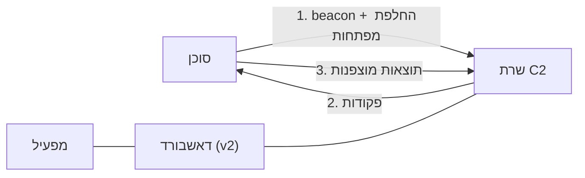

[English](README.md) | [עברית](README.he.md)

# Encrypted C2 Framework

ממשק **Command & Control** (c2) שנכתב לצורך לימודי תכנות ותקשורת - בשפת Python.
הממשק נכתב  כדי ללמוד כיצד תשתית כזו עובדת מקצה לקצה: תכנות רשת, קריפטוגרפיה, עיצוב פרוטוקול מותאם, כלי הפעלה, והתחמקות בסיסית.
 הרפו מכיל שתי גרסאות אבולוציוניות שחולקות ליבה קריפטוגרפית אחת ונבדלות בשכבת התקשורת.


-green)


> **לשימוש מורשה בלבד.** זהו פרויקט לימודי שנועד לרוץ ב־lab מבוקר, מול מכונות שבבעלותך (למשל המחשב שלך דרך localhost). הרצת תוכנת C2 או ניהול-מרחוק מול מערכות שאינן שלך, או שאין לך אישור בכתב לבדוק אותן, אינה חוקית ברוב המקומות. האחריות על השימוש היא עליך.

## תוכן

- [הליבה המשותפת](#הליבה-המשותפת)
- [שתי הגרסאות](#שתי-הגרסאות)
- -גרסה **בסיסית** [v1 — Raw TCP Sockets](#גרסת-הבסיס-v1---tcp-sockets)
- גרסה **מתקדמת** [v2 — HTTP Tunneling](#פרויקט-הדגל-v2---http-tunneling-c2)
- [הערות תכנון](#הערות-תכנון)
- [איך זה מתחבר יחד](#איך-זה-מתחבר-יחד)
- [מבנה הפרויקט](#מבנה-הפרויקט)
- [דרישות](#דרישות)
- [הרצה ב־lab](#הרצה-ב-lab)
- [כיוונים להמשך](#כיוונים-להמשך)
- [הבהרה](#הבהרה)

## הליבה המשותפת

שתי הגרסאות יושבות על אותה ליבה שנכתבה בתחילת הפרוייקט.
הרעיון היה לממש את החלקים הקשים בעצמי וללמוד כיצד הם פועלים - במקום להשתמש בספריות מוכנות:

- **א** מימוש **RSA מאפס.** יצירת מספרים ראשוניים, מפתח ציבורי, והמפתח הפרטי באמצעות האלגוריתם האוקלידי המורחב - הכל מומש ישירות. 
	- השימוש ב-RSA רלוונטי רק בתחילת התקשורת בין הלקוח לשרת, כדי לתאם את מפתח ההצפנה הסימטרי.
- **ב** מימוש הצפנה **AES-CBC.** אחרי ה-handshake כל הודעה מוצפנת ב-AES-CBC, עם PKCS7 padding ו-IV אקראי חדש של 16 בתים לכל הודעה. ה-IV מוצמד לפני ה-ciphertext (`iv + ciphertext`) ונחתך בצד המקבל, כך שכל הודעה נושאת את כל מה שצריך כדי לפענח אותה.
- **ג** **פרוטוקול תקשורת סימטרי.** `create_protocoled_msg` עוטף הודעה כ-header קבוע של 6 בתים (little-endian) ואחריו ה-payload (עד 2^48 בתים); `recv_protocoled_msg` מפענח אותו בתיאום מושלם - קורא את ה-header, מפענח את האורך, וקורא בדיוק את מספר הבתים הזה עם `recv_exact`, כך ששני הצדדים לעולם לא מאבדים סנכרון.
- **ד** **גבול ברור בין int ל-bytes.**  המימוש של RSA עובד על מספרים שלמים (חזקה מודולרית); כל השאר (מפתחות, הקו, AES, קבצים) זה bytes. ההמרות קורות רק בגבול של RSA, עם אורך קבוע ו-byte order עקבי, כך שמפתח חוזר byte to byte.
- **ה** **טיפול ידני בסוגי מידע שונים.** טקסט, פקודות מובנות, ו-payload בינארי (קבצים, תמונות) עוברים סריאליזציה והרכבה מחדש בשכבת הפרוטוקול. בינארי מזוהה לפי Magic Numbers (למשל חתימת PNG) ומועבר כבתים גולמיים במקום UTF-8 decode שנועד לטקסט.

## שתי הגרסאות

שתיהן חולקות את הליבה שלמעלה. ההבדל הוא בשכבת התקשורת, ובמעבר מסוקט stateful לארכיטקטורת web מסוג stateless.

|               | v1 - Raw TCP Sockets                                      | v2 - HTTP Tunneling (Flask)                                |
| ------------- | --------------------------------------------------------- | ---------------------------------------------------------- |
| תקשורת        | סוקטים ישירים ורציפים (TCP)                               | HTTP GET / POST מעל שרת Flask                              |
| אופי החיבור   | Stateful (החיבור נשאר פתוח)                               | Stateless (דגימת Polling מחזורית עם sleep)                 |
| ניהול סוכנים  | Thread לכל לקוח + מילון חיבורים פעילים                    | תור משימות ומחסנית מפתחות לכל לקוח, לפי Client-ID ב־header |
| מסגור / קידוד | header 6 בתים + `RECV_EXACT`, זיהוי Magic Numbers לבינארי | JSON מעל HTTP + Base64 למידע מוצפן וקבצים                  |
| Handshake     | מיידי, ברצף, בפתיחת הסוקט                                 | Stateless: הבקשות הראשונות שמורות לסנכרון מפתחות           |
| ממשק הפעלה    | CLI                                                       | דאשבורד web + תהליכון ניטור                                |

את v1 כתבתי קודם בכוונה: ליצוק בסיס ולוודא שהלוגיקה המרכזית נכונה, לפני הקפיצה לגרסה המורכבת יותר מעל HTTP.

## גרסת הבסיס v1 - TCP Sockets

- **חיבור:** TCP ישיר ו־stateful. החיבור נשאר פתוח והשרת שולח משימות בזמן אמת.
- **מקביליות:** שרת מבוסס multi-threading, תהליכון נפרד לכל לקוח מחובר, כשהחיבורים הפעילים נשמרים במילון.
- **מסגור:** פרוטוקול ה־header של 6 הבתים יחד עם `RECV_EXACT` לקריאה מדויקת מהזרם.
- י**Handshake:** מתבצע מיד עם פתיחת הסוקט. השרת שולח מפתח ציבורי ומודולו (N), והלקוח מצפין ומחזיר מפתח סשן של AES.
- **קבצים בינאריים:** בתים גולמיים נשלחים ישירות על הסוקט, עם זיהוי Magic Numbers כדי לדלג על נתיב ה־UTF-8 decode שמשמש לטקסט.
- **ממשק:** CLI בלבד.

## פרויקט הדגל v2 - HTTP Tunneling C2 

- **חיבור:** ארכיטקטורת web סטנדרטית מעל Flask (GET / POST), לתאימות עם סביבות רשת רגילות. התקשורת stateless ומבוססת Polling מחזורי (beacons): הלקוח דוגם את השרת כל כמה שניות, מושך משימה ממתינה ומחזיר את הפלט.
- **ניהול וניתוב סוכנים:** השרת חושף endpoints ייעודיים (למשל `/getcommands`, `/getkeys`). מכיוון שאין חיבור קבוע, כל סוכן מזוהה לפי Client-ID ייחודי שנשלח ב־header של הבקשה. השרת מנהל תור משימות ומחסנית מפתחות בנפרד לכל לקוח, כולל טיפול בניתוקים וגישה בטוחה מפני Race Conditions.
- **קידוד:** מכיוון שהתעבורה עוברת מעל HTTP/JSON ולא כזרם בתים גולמי, מידע מוצפן וקבצים בינאריים מקודדים ב־Base64. (גרסה מוקדמת יותר שהמירה ל־INT ואז ל־STR קרסה על payload גדול כמו תמונות, וזה מה שהוביל למעבר ל־Base64.)
- **החלפת מפתחות (JSON):** השרת חושף את המפתח הציבורי ואת המודולו כתשובת JSON אחת (`{"public_key": ..., "N": ...}`). הלקוח קורא את שניהם, מצפין איתם מפתח AES חדש לסשן, ושולח אותו חזרה ב-POST. רק אחרי שהשרת מאמת ומפענח את המפתח, סטטוס ההצפנה של הלקוח נדלק ומשיכת המשימות השוטפת מתחילה.
- **ממשק וניטור:** דאשבורד web, ובנוסף תהליכון רקע שמדפיס את מצב התורים והמשימות הממתינות במרווחים קבועים.
- **דאשבורד מפעיל:** ממשק web שמדבר עם השרת דרך שני endpoints - `GET /api/status` (מציג סוכנים מחוברים, גודל התור, תשובות אחרונות, צילום אחרון) ו-`POST /api/send_command` (מכניס פקודה לתור עבור סוכן). ערוץ הadmin הנ"ל נפרד מערוץ הagent המוצפן.

## הערות תכנון

כמה החלטות הנדסיות שעיצבו את הקוד:

- **ניתוב פקודות דרך טבלת lookup.** בשרת הסוקטים ובלקוח ה-HTTP, פקודות נכנסות מנותבות דרך מילון שממפה שם פקודה ל-handler, במקום בלוק `match` ענק. כל פקודה היא פונקציה מבודדת עם חתימה אחידה, כך שהוספת פקודה היא שורה אחת, וכל handler ניתן לבדיקה בנפרד.
- **הפרדת אחריות.** תקשורת (מסגור וקריאה מהזרם), קריפטוגרפיה (RSA ו-AES), ולוגיקת הפקודות יושבות במודולים נפרדים (`PROTOCOLS`, `encryptions`, `OPERATIONS`). הוצאת ה-I/O מפונקציות הקריפטו הופכת אותן לטהורות וניתנות לבדיקה.
- **ת'רד לכל לקוח.** השרת נותן לכל חיבור ת'רד משלו, שמקים את הסשן (החלפת מפתחות), רץ בלולאה על הודעות מוצפנות, ומנקה ביציאה.
- **פיד תשובות חסום ו-thread-safe.** פיד התשובות האחרונות של הדאשבורד משתמש ב-`collections.deque(maxlen=N)` במקום רשימה שגדלה: הכנסה O(1) לראש, חסימה אוטומטית כך שהזיכרון נשאר מוגבל, והוספות thread-safe תחת השרת הרב-threaded.
- י**API מסוג JSON.** חומר המפתחות והמשימות עוברים בין הסוכן לשרת כשדות JSON בשם (`public_key`, `N`, `iv`, `msg`) מעל HTTP, במקום payloads לפי מיקום או prefix.
- **נתיבים מעוגנים, לוגים מרוכזים.** מיקומי הקבצים מחושבים יחסית לקובץ עצמו דרך מודול `paths` אחד, והלוגים מוגדרים פעם אחת בהפעלה, כך שהפרויקט מתנהג זהה מכל תיקיית הרצה.

## איך זה מתחבר יחד



הסוכן פונה לשרת, מבצע את החלפת המפתחות במגע הראשון, ואז מושך משימות ומחזיר תוצאות מוצפנות. ב־v2 המפעיל מנהל הכל מהדאשבורד.

## מבנה הפרויקט

```
.
├── src/
│   ├── shared/              ליבה לשתי הגרסאות
│   │   ├── encryptions.py       RSA + AES-CBC, מימוש ידני
│   │   ├── PROTOCOLS.py         פרוטוקול header 6 בתים + RECV_EXACT
│   │   └── OPERATIONS.py        טיפול בפקודות
│   ├── v1/                  Raw TCP sockets (הבסיס)
│   │   ├── socket_server.py
│   │   └── socket_agent.py
│   └── v2/                  HTTP Tunneling (פרויקט הדגל)
│       ├── http_server.py
│       └── http_client.py
├── dashboard/
│   └── dashboard.html       הדאשבורד שמוגש ע"י שרת v2
├── requirements.txt
└── README.md
```

## דרישות

- Python 3.10 ומעלה
- ראה `requirements.txt` (Flask, requests, cryptography, sympy, loguru, pyautogui)

```bash
pip install -r requirements.txt
```

## הרצה ב־lab

זו תוכנת lab. הרץ את השרת ואת הסוכן על מכונה שבשליטתך (למשל שניהם על אותו מחשב דרך localhost).

1. הפעל את השרת (v1: `src/v1/socket_server.py`, v2: `src/v2/http_server.py`).
2. הפעל את הסוכן (v1: `src/v1/socket_agent.py`, v2: `src/v2/http_client.py`) מכוון לאותו שרת.
3. ב־v2, פתח את הדאשבורד כדי לצפות בסוכן מתחבר ולשלוח פקודות.


## כיוונים להמשך 

גם גרסה V2, אשר מציגה שיפור משמעותי לעומת V1 הבסיסית, נדרשת בשדרוג ביחס לסטנדרט הנדרש לפרוייקט מסוג זה.
להלן מס' כיוונים:
- הטמעת TLS HANDSHAKE כדי להצפין את כלל הסשן ומניעת חשיפה של מבנה השדות או ניתובים בשרת.
- תמיכה במספר רב של סוכנים.
- הוספת Authenticated Encryption (HMAC מעל ה-ciphertext, או מעבר ל-AES-GCM) - כיום AES-CBC אינו מאומת, ואין הגנה מפני שינוי (tampering) של המידע המוצפן.
- מעבר הדאשבורד ל-push מבוסס SSE במקום polling, ו-jitter למרווחי ה-beacon של הסוכן (עדכון מיידי + פחות ניתן לזיהוי).
- כתיבת בדיקות יחידה (Unit Tests) לשכבת ההצפנה והפרוטוקול, שנבנו כפונקציות טהורות וניתנות לבדיקה.
## הבהרה

הפרויקט נועד ללמידה ולבדיקות מורשות בלבד, ב־lab שבשליטתך או מול מערכות שקיבלת עליהן אישור מפורש בכתב. הרצת תוכנת command-and-control או ניהול-מרחוק מול רשתות או מכשירים ללא הרשאה אינה חוקית ברוב המדינות. הכותב אינו אחראי לשימוש לרעה או לנזק שייגרם מהקוד הזה.
