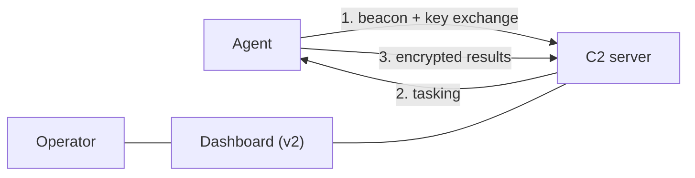

[English](README.md) | [עברית](README.he.md)

# Encrypted C2 Framework

A **Command & Control** (C2) framework written in Python, for learning programming and networking.
It was written to learn how such infrastructure works end to end: network programming, cryptography, custom protocol design, operator tooling, and basic evasion.
The repository holds two evolutionary versions that share one cryptographic core and differ in their transport layer.


-green)


> **Authorized use only.** This is a learning project meant to run in a controlled lab, against machines you own (for example your own host over localhost). Running C2 or remote-administration software against systems you do not own, or have no written permission to test, is illegal in most places. You are responsible for how you use this code.

## Contents

- [Shared core](#shared-core)
- [The two versions](#the-two-versions)
- Basic version - [v1 - Raw TCP Sockets](#v1--baseline-raw-tcp-sockets)
- Advanced version - [v2 - HTTP Tunneling](#v2--flagship-http-tunneling-c2)
- [Design notes](#design-notes)
- [How it fits together](#how-it-fits-together)
- [Project structure](#project-structure)
- [Requirements](#requirements)
- [Running it in a lab](#running-it-in-a-lab)
- [Future directions](#future-directions)
- [Disclaimer](#disclaimer)

## Shared core

Both versions sit on the same core, written at the start of the project.
The idea was to implement the hard parts myself and learn how they work, instead of using ready to use libraries:

- **(a) RSA from scratch.** Prime generation, the public key, and the private key via the Extended Euclidean algorithm - all implemented directly.
  - RSA is used only at the start of the client–server communication, to coordinate the symmetric encryption key.
- **(b) AES-CBC encryption.** After the handshake, every message is encrypted with AES-CBC, using PKCS7 padding and a fresh random 16-byte IV per message. The IV is prepended to the ciphertext (`iv + ciphertext`) and stripped on the receiving side, so each message carries everything needed to decrypt it.
- **(c) A symmetric wire protocol.** `create_protocoled_msg` frames a message as a fixed 6-byte header (little-endian) followed by the payload (up to 2^48 bytes); `recv_protocoled_msg` mirrors it exactly - reads the header, decodes the length, and reads exactly that many bytes with `recv_exact`, so the two sides never desynchronize.
- **(d) A clear int/bytes boundary.** The RSA implementation works on integers (modular exponentiation); everything else (keys, the wire, AES, files) is bytes. Conversions happen only at the RSA boundary, with a fixed length and a consistent byte order, so a key round-trips byte for byte.
- **(e) Manual handling of different data types.** Text, structured commands, and binary payloads (files, images) are serialized and reassembled by the protocol layer. Binary is detected by its magic numbers (for example the PNG signature) and passed through as raw bytes instead of a UTF-8 decode meant for text.

## The two versions

Both share the core above. The difference is the transport layer, and the move from a stateful socket to a stateless web architecture.

|  | v1 - Raw TCP Sockets | v2 - HTTP Tunneling (Flask) |
|---|---|---|
| Transport | Direct, continuous TCP sockets | HTTP GET / POST over a Flask server |
| Connection | Stateful (connection stays open) | Stateless (periodic polling with sleep) |
| Agent tracking | Thread per client + dict of active connections | Per-client task queue and key store, by Client-ID in the header |
| Framing / encoding | 6-byte header + `RECV_EXACT`, magic-number detection for binary | JSON over HTTP + Base64 for encrypted data and files |
| Handshake | Immediate, in sequence, on socket open | Stateless: first requests reserved for key sync |
| Operator UI | CLI | Web dashboard + a monitor thread |

I wrote v1 first on purpose: to lay a base and verify the core logic before jumping to the more complex HTTP version.

## v1 - Baseline: Raw TCP Sockets

- **Connection:** Direct, stateful TCP. The connection stays open and the server sends tasks in real time.
- **Concurrency:** A multi-threaded server, a separate thread per connected client, with active connections held in a dictionary.
- **Framing:** The 6-byte-header protocol together with `RECV_EXACT` for exact reads off the stream.
- **Handshake:** Runs immediately when the socket opens. The server sends the public key and modulus (N); the client encrypts and returns an AES session key.
- **Binary files:** Raw bytes are sent directly over the socket, with magic-number detection to skip the UTF-8 decode path used for text.
- **Interface:** CLI only.

## v2 - Flagship: HTTP Tunneling C2

- **Connection:** A standard web architecture over Flask (GET / POST), for compatibility with ordinary network environments. Communication is stateless and based on periodic polling (beacons): the client polls the server every few seconds, pulls a pending task, and returns the output.
- **Agent tracking and routing:** The server exposes dedicated endpoints (for example `/getcommands`, `/getkeys`). With no persistent connection, each agent is identified by a unique Client-ID sent in the request header. The server keeps a separate task queue and key store per client, with disconnect handling and race-condition-safe access.
- **Encoding:** Since traffic rides over HTTP/JSON rather than a raw byte stream, encrypted data and binary files are Base64-encoded. (An earlier version that converted to INT and then to STR broke on large payloads such as images, which drove the move to Base64.)
- **Key exchange (JSON):** The server exposes the public key and modulus as a single JSON response (`{"public_key": ..., "N": ...}`). The client reads both, encrypts a fresh AES session key with them, and sends it back via POST. Only once the server verifies and decrypts that key does the client's encrypted status turn on and regular task-pulling begin.
- **Interface and monitoring:** A web dashboard, plus a background thread that prints the state of the queues and pending tasks at fixed intervals.
- **Operator dashboard:** A web UI that talks to the server over two endpoints - `GET /api/status` (shows connected agents, queue size, recent responses, latest screenshot) and `POST /api/send_command` (queues a command for an agent). This operator channel is separate from the encrypted agent channel.

## Design notes

A few engineering choices that shaped the code:

- **Command dispatch over a lookup table.** On the socket server and the HTTP client, incoming commands are routed through a dictionary that maps a command name to its handler, instead of one large `match` block. Each command is an isolated, uniformly-typed function, so adding one is a single entry and every handler can be tested on its own.
- **Separation of concerns.** Transport (framing and stream reads), cryptography (RSA and AES), and command logic live in separate modules (`PROTOCOLS`, `encryptions`, `OPERATIONS`). Keeping I/O out of the crypto functions makes them pure and testable.
- **One thread per client.** The server hands each connection its own thread, which sets up the session (key exchange), loops over encrypted messages, and cleans up on exit.
- **Bounded, thread-safe response feed.** The dashboard's recent-responses feed uses `collections.deque(maxlen=N)` rather than a growing list: O(1) inserts at the front, automatic capping so memory stays bounded, and thread-safe appends under the multi-threaded server.
- **A typed JSON API.** Key material and tasking move between agent and server as named JSON fields (`public_key`, `N`, `iv`, `msg`) over HTTP, instead of positional or prefix-encoded payloads.
- **Anchored paths, centralized logging.** File locations are computed relative to the file itself through one `paths` module, and logging is configured once at startup, so the project behaves the same from any working directory.


# Known Limitations & Production Notes

> This project is an educational / lab exercise. It is **not** hardened for
> real-world use. The notes below document the current security properties
> and how you would harden them in practice.

**Payload-only encryption.**
Encryption is applied to the message payload only. The protocol framing
(the fixed-size length header and message markers) travels in cleartext, so
an observer on the wire can see message boundaries, sizes, and timing even
though the content itself is encrypted. Metadata is not protected.

**No transport security.**
The custom RSA/AES layer exists to demonstrate the cryptographic building
blocks from scratch - not to replace a vetted transport. For any real
deployment you would run the channel over TLS and treat the
application-layer crypto as defense-in-depth, not the primary protection.

**Confidentiality without integrity (no authentication).**
AES-CBC provides confidentiality but not integrity: a message can be
tampered with on the wire without detection, and CBC without a MAC is
exposed to padding-oracle-style attacks. The correct fix is authenticated
encryption - either Encrypt-then-MAC with HMAC-SHA256 over the ciphertext,
or switching the cipher to AES-GCM. This is a known limitation and a
planned improvement, not a design decision.

## How it fits together



The agent reaches out to the server, performs the key exchange on first contact, then pulls tasking and returns encrypted results. In v2 the operator drives everything from the dashboard.

## Project structure

```
.
├── src/
│   ├── shared/              core used by both versions
│   │   ├── encryptions.py       RSA + AES-CBC, implemented by hand
│   │   ├── PROTOCOLS.py         6-byte-header wire protocol + RECV_EXACT
│   │   └── OPERATIONS.py        command handling
│   ├── v1/                  Raw TCP sockets (the baseline)
│   │   ├── socket_server.py
│   │   └── socket_agent.py
│   └── v2/                  HTTP Tunneling (the flagship)
│       ├── http_server.py
│       └── http_client.py
├── dashboard/
│   └── dashboard.html       dashboard served by the v2 server
├── requirements.txt
└── README.md
```

## Requirements

- Python 3.10+
- See `requirements.txt` (Flask, requests, cryptography, sympy, loguru, pyautogui)

```bash
pip install -r requirements.txt
```

## Running it in a lab

This is lab software. Run the server and the agent on a machine you control (for example both on the same host over localhost).

1. Start the server (v1: `src/v1/socket_server.py`, v2: `src/v2/http_server.py`).
2. Start the agent (v1: `src/v1/socket_agent.py`, v2: `src/v2/http_client.py`) pointed at that server.
3. In v2, open the dashboard to watch the agent connect and to send commands.

## Future directions

v2, though a significant improvement over the basic v1, still needs work to meet the standard expected of a project of this kind. A few directions:

- Add a TLS handshake to encrypt the entire session and prevent exposure of the field structure or the server's routes.
- Support for a large number of agents.
- Add authenticated encryption (an HMAC over the ciphertext, or a move to AES-GCM) - AES-CBC today is not authenticated, so there is no protection against tampering with the encrypted data.
- Move the dashboard to SSE-based push instead of polling, and add jitter to the agent's beacon intervals (instant updates + harder to detect).
- Write unit tests for the encryption and protocol layers, which were built as pure, testable functions.


## Disclaimer

This project is for education and for authorized testing only, in a lab you control or against systems you have explicit written permission to test. Running command-and-control or remote-administration software against networks or devices without authorization is illegal in most jurisdictions. The author is not responsible for any misuse or damage caused by this code.
